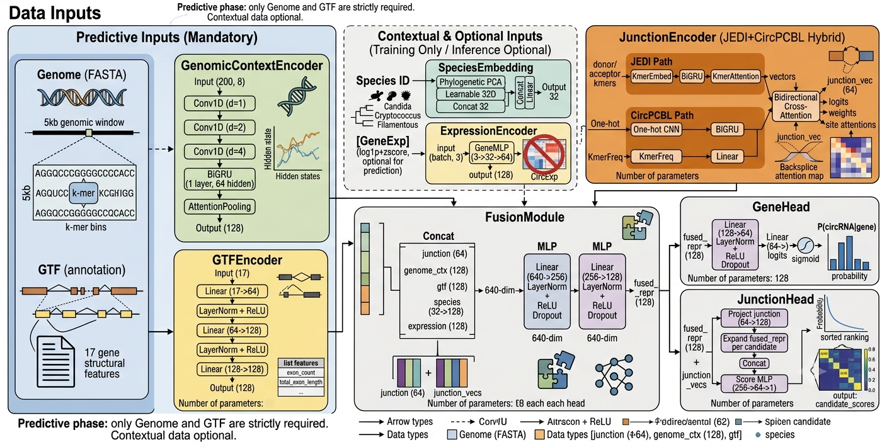

# 🍄 mycoCirc — Pan-Fungi CircRNA Foundation Model

> *myco* (fungus) + *Circ* (circular RNA) — a multi-modal foundation model for end-to-end circRNA prediction from fungal genomes.

**Author:** Yukkikou ([xueyanhu@pku.edu.cn](mailto:xueyanhu@pku.edu.cn))

[]()
[]()


*Figure 1: mycoCirc model architecture — multi-modal fusion of genome sequence, gene annotation, and circRNA metadata.*

**mycoCirc** is a multi-modal deep learning model that predicts **which genes produce circular RNAs (circRNAs)** and **which backsplice junction is most likely**, directly from a fungal genome sequence and gene annotation.

Unlike existing single-modal methods (JEDI, CircPCBL), mycoCirc integrates **five distinct modalities** during pre-training and fine-tuning. The model is pre-trained on 22 fungal strains spanning three major taxonomic groups (Candida, Cryptococcus, Filamentous) and demonstrates strong **cross-species generalization**: a model fine-tuned on one group can predict circRNA genes in phylogenetically related fungal species not seen during training, including entirely unseen genera. This makes mycoCirc applicable to a broad range of fungal species beyond the original training set.

---

## Architecture Overview

```
Gene-level input:
  GTF  (gene structure)  ──→ GTFEncoder ──┐
  Species ID             ──→ SpeciesEmb ───┤
  Genome window (10 kb)  ──→ GenomicCtxEnc ─┼─→ FusionModule ─→ GeneHead → P(circRNA|gene)
  [FT] CircExp           ──→ ExpEncoder ───┘
  [FT] GeneExp           ──→ ExpEncoder ───┘

Junction-level (per gene):
  All exon 5' boundaries  ──→ k-mer embed → BiGRU → k-mer attn → donor vectors (N_d)
  All exon 3' boundaries  ──→ k-mer embed → BiGRU → k-mer attn → acceptor vectors (N_a)
                                    ↓
                    Bidirectional cross-attention (JEDI core)
                          (donor↔acceptor pairwise scores)
                                    ↓
                    Final attention pooling → junction vector → fusion
```

### Components

| Component | Dim. | Description |
|-----------|------|-------------|
| **GenomicContextEncoder** | 128 | Dilated CNN + BiGRU on GC/k-mer profile bins of the ±5 kb gene window |
| **GTFEncoder** | 128 | MLP on 17 gene-structure features (exon count, intron length, CDS, etc.) |
| **JunctionEncoder** | 64 | JEDI (BiGRU + cross-attention) + CircPCBL (CNN-BiGRU + GLT) hybrid |
| **SpeciesEmbedding** | 32 | Phylogenetic PCA + learnable embedding (21 species) |
| **ExpressionEncoder** | 64 | log1p + z-score of CircExp & GeneExp (fine-tuning only) |
| **FusionModule** | 128 | Concat-MLP: project each modality, concatenate, refine |
| **GeneHead** | → 1 | Linear → sigmoid → P(circRNA\|gene) |
| **JunctionHead** | → scores | MLP scoring of candidate exon pairs (backup ranking) |

**Total parameters:** 775,858

---

## Training Protocol

### Two-Stage Pre-training

| Stage | Epochs | Trainable Modules | Loss |
|-------|--------|-------------------|------|
| **Stage 1** | 50 | GTFEncoder + GenomicCtxEncoder + Fusion + GeneHead | BCE(gene) |
| **Stage 2** | 100 | All (unfreeze JunctionEncoder) | BCE(gene) + BCE(junction) |

### Fine-tuning (per taxonomic group)

- **5-fold cross-validation** by strain: train on N-1 strains, validate on 1
- Best fold model → evaluate on held-out test strain
- Two modes:
  - **Mode A** (Genome+GTF): no expression data needed
  - **Mode B** (+GeneExp): with host gene expression

### Test Strains

| Group | Training Strains | Held-out Test |
|-------|-----------------|---------------|
| **Candida** | *C. albicans*, *C. tropicalis*, *C. glabrata* (×2), *P. kudriavzevii*, *S. cerevisiae* | **_C. auris_** |
| **Cryptococcus** | *C. neoformans* var. *grubii* (×2), *C. floricola*, *C. gattii* (×2), *C. laurentii* | **_C. neoformans_ var. _neoformans_** |
| **Filamentous** | *F. proliferatum*, *F. dimerum*, *N. crassa*, *A. fumigatus*, *P. chrysogenum* | **_F. venenatum_** |

### Optional: supplying a species tree (phylogenetic features)

By default the model uses a learned species lookup embedding and, for species
unseen during training, a single default slot. If you work on a clade where a
**well-resolved species tree is available** and you have enough training
strains, you can additionally supply phylogenetic features:

```bash
# 1) compute PCA features from an ultrametric Newick tree
python scripts/compute_phylogeny_embedding.py \
    --tsv all_lib_model_full.tsv \
    --tree /path/to/your_tree.nwk \
    --output checkpoints/phylogeny            # writes phylo_pca_features.npy

# 2) pass them to pre-training and/or fine-tuning
python train/pretrain.py --config config/default.yaml \
    --phylo-features checkpoints/phylogeny/phylo_pca_features.npy

python train/finetune.py --group Candida --pretrained checkpoints/pretrain/best.pt \
    --phylo-features checkpoints/phylogeny/phylo_pca_features.npy
```

The file must be a NumPy array of shape `(n_strains, phylo_pca_dims)` (default
`phylo_pca_dims = 8`), ordered exactly as the strains returned by
`data.tsv_parser.build_strain_index()` over the active (non-excluded) strains;
`compute_phylogeny_embedding.py` writes both the array and
`phylo_strain_order.txt` so the order can be checked.

**Note.** In the checkpoints released with the paper this pathway was left at
its default (all-zero) state: with 22 training strains and no tree that is
comparable across the 768 atlas genomes, we found no evidence that
species-resolved phylogenetic information improves prediction (see the modality
ablation in the manuscript, where zeroing the species modality changes AUROC by
≈0). The option is provided for users who do have a suitable tree for a
smaller, well-characterised clade.

---

## Results Summary

### Cross-species circRNA Prediction (AUROC)

| Method | Candida | Cryptococcus | Filamentous |
|--------|:-------:|:------------:|:-----------:|
| **mycoCirc** (Genome+GTF) | **0.6985** | **0.6902** | **0.6976** |
| mycoCirc (+GeneExp) | 0.4526 | 0.5698 | 0.7227 |
| From-scratch (no pretrain) | 0.4992 | 0.5411 | 0.5053 |
| JEDI | 0.5057 | 0.5341 | 0.5656 |
| CircPCBL | 0.5329 | 0.4925 | 0.4927 |

### Key Findings

- **Pre-training is essential**: from-scratch collapses to ~random (AUROC ~0.50–0.54)
- **GTFEncoder is the dominant modality**: removing it drops AUROC by 0.06–0.14
- **JunctionEncoder contributes modestly**: consistent +0.01–0.04 AUROC across groups
- **Expression helps within-group but not cross-species**: Mode B inconsistent
- **Cross-species generalization** to unseen *Talaromyces marneffei* (PM1): AUROC 0.6955

### Junction Prediction Accuracy

*(Results from `results/interpretability/junction_topk.tsv` — see below)*

---

## Revision Module (revision/)

Analyses added in revision of the manuscript, kept self-contained so that
nothing in the published pipeline changes. Includes confidence intervals
and paired DeLong tests for every reported AUROC, matched-negative
robustness, GTF-only and CircPCBL-retrained baselines, genome-wide
threshold/calibration analysis, expression-detectability probe, and a
species-embedding sensitivity study — plus the response letter, manuscript
text-edit lists and two supplementary figures.

A separate release bundle (`revision/release/`) groups the
manuscript-reproducing checkpoints and the alternatively-trained
`updated_recipe` checkpoints; see `revision/README.md` for the map from
each reviewer comment to its evidence file.

---

## Determinants of circRNA Production (determinants/ module)

*What drives fungal circRNA formation?* A dedicated analysis module (`determinants/`, self-contained: lib + scripts + SLURM + results + figures + report) tests 13 candidate factors across the 20 event-bearing training strains. Positives are anchored on circ coordinates; negatives are non-circular exons matched on exon length, host expression, exon count **and flank GC**; statistics are strain-stratified (Mantel-Haenszel) with phylogenetic independent contrasts (PIC) where cross-strain.

**Full report: `determinants/determinants_report.md` · figures: `determinants/figures/det_*.pdf` · raw tables: `determinants/results/`**

| Factor | Candida | Cryptococcus | Filamentous | Verdict |
|--------|:-------:|:------------:|:-----------:|---------|
| **Donor splice-site strength** | n.e.† | **Δ=+0.81 bit** (p=2e-12) | **Δ=+1.01 bit** (p=2e-33) | ✅ strongest sequence determinant |
| Acceptor strength | n.e.† | Δ=−1.08 (p=3e-4) | ns | ⚠️ asymmetric (weak acceptor) |
| **Flanking GC elevation** | **+0.038** (7/7) | +0.002 (6/6) | **+0.023** (7/7) | ✅ conserved (C7 reversed) |
| **Purine GAAG-core motifs** | **GAAG OR=4.15** | ~1.5× (CTCC/TACC) | CGAG 1.87 / GAAG 1.69 | ✅ GAAG shared Candida+Filamentous; converges with MEME de-novo (AAGAAG, E=9e-195) |
| RCS / hairpin pairing | **less** (q<1e-52) | none | ≈0 after GC control | ❌ hairpin-driven backsplicing **not** the fungal mechanism |
| circ-transcript structure vs abundance | ns | **rho=+0.20** (q=2e-4) | ns | ⚠️ Cryptococcus only |
| Flank local fold stability (MFE/nt) | **−0.036** (q=1e-106) | ns | **−0.009** (q=3e-57) | ✅ locally more structured |
| Inter-arm (cross-junction) pairs | fewer | fewer | fewer | ❌ corroborates the RCS negative |
| **Spliceosome family expression vs circ density** | rho 0.61–0.73, **all 6 families q<0.01**; lariat/debranch 0.73 (PIC 0.67, q=0.003) | | | ✅ strongest gene-level determinant |
| Spliceosome expression vs per-circ abundance | rho −0.48…−0.54 (**PIC −0.93**) | | | ✅ inverse: many-but-low-abundance |
| Splicing-gene presence/copy number | all q>0.9 | | | ❌ expression, not gene content |
| Model-side (mutagenesis / attention∩motif) | p=4e-118 | sensitivity 0.088; attention ns | p=2e-83 | ⚠️ corroborates in 2/3 groups |

† Candida not evaluable: circ boundaries almost never coincide with annotated exon boundaries (exact rate <0.4%).

**Integrated model.** Fungal circRNA production is governed by **strong donor splice sites + purine/G-elevated proximal flanks (GAAG-core motifs) + locally (not cross-junction) stable flank structure**, globally modulated by the strain's **spliceosome expression level — especially the lariat/debranching pathway** — while the hairpin/complementary-repeat mechanism dominant in animals and plants **does not operate in fungi**.

**Run it:** `determinants/scripts/det_strain_qc.py → det_build_cache.py → det_a_*/det_b/det_c → det_d (GPU) → det_figures_report.py`; SLURM wrappers in `determinants/slurm/`. External tools (samtools/RNAfold/MEME) run via read-only Singularity images (`lib/containers.py` handles the login-node `--no-mount /work` quirk).

---

## Quick Start

📖 完整教程（安装 → 下载权重 → 运行预测 → 结果解读）见 **[QUICKSTART.md](QUICKSTART.md)**。

快速上手：

```bash
# 1. 预训练权重位于 model_weights/ 目录
ls model_weights/

# 2. 运行预测（需要 genome.fa + annotation.gtf）
python scripts/predict.py \
    --genome genome.fa \
    --gtf annotation.gtf \
    --checkpoint model_weights/mycoCirc_filamentous.pt \
    --config config/default.yaml \
    --output predictions.tsv

# 3. 查看结果（p_circ ≥ 0.5 为预测阳性）
head predictions.tsv
```

---

## Test Dataset

A test dataset of 4 fungal species is provided to verify the model installation and reproduce cross-species evaluation results.

**Download test data:**

```bash
# Download from GitHub Releases
wget https://github.com/yukkikou/mycoCirc/releases/download/v1.0/test_data.tar.gz
tar xzf test_data.tar.gz
```

**Run prediction on all test species:**

```bash
bash test_data/predict_test.sh --checkpoint model_weights/mycoCirc_filamentous.pt
```

**Input format** (per species):

| File | Format | Description |
|------|--------|-------------|
| `test_data/genomes/{species}.fa` | FASTA | Reference genome (multi-FASTA) |
| `test_data/annotations/{species}.gtf` | GTF | Gene annotation with exon, CDS, transcript features |

**Output format** (`test_data/expected_output/{species}_predicted.tsv`):

| Column | Type | Description |
|--------|------|-------------|
| `gene_id` | string | Gene identifier (from GTF) |
| `chrom` | string | Chromosome / scaffold name |
| `start` | int | Gene start coordinate (1-based) |
| `end` | int | Gene end coordinate (1-based) |
| `strand` | string | Genomic strand (+ or -) |
| `p_circ` | float | Predicted probability that this gene produces a circRNA [0–1] |
| `n_exons` | int | Number of exons in the gene |

**Test species:**

| Species | Taxonomy | Genes | Expected p≥0.5 |
|---------|----------|------:|:--------------:|
| *Aspergillus cristatus* | Filamentous (Ascomycota) | 10,596 | ~1,129 |
| *Trichophyton rubrum* | Filamentous (Ascomycota) | 7,051 | ~1,375 |
| *Trichophyton mentagrophytes* | Filamentous (Ascomycota) | 7,958 | ~1,127 |
| *Talaromyces marneffei* | Filamentous (Ascomycota) | 10,378 | ~2,348 |

**Available checkpoints:**

| File | Model |
|------|-------|
| `mycoCirc_filamentous.pt` | Filamentous fungi (recommended for these species) |
| `mycoCirc_candida.pt` | Ascomycete yeast |
| `mycoCirc_cryptococcus.pt` | Basidiomycete yeast |

The `--checkpoint` flag selects which fine-tuned model to use. Pre-computed results for each checkpoint are in `test_data/expected_output/`.

---

## Architecture Overview

### Requirements

```
Python  ≥3.9
PyTorch ≥2.0 (CUDA recommended)
NumPy, Pandas, scikit-learn
Biopython, pyfaidx
matplotlib, seaborn
tqdm, pyyaml, scipy
```

### 1. Prepare Data

Ensure `all_lib_model_full.tsv` is in the project root with correct paths to:
- Reference genome FASTA files
- Gene annotation GTF files
- CircRNA metadata CSV (from CIRIquant or similar)
- Optional: CircExp BSJ count and GeneExp count matrices

```bash
# Validate the TSV
python scripts/parse_tsv.py
```

### 2. Pre-train

```bash
# Single GPU
python train/pretrain.py --config config/default.yaml

# Multi-GPU
accelerate launch train/pretrain.py --config config/default.yaml
```

### 3. Fine-tune

```bash
# Fine-tune with 5-fold CV for a specific group
python train/finetune.py --group Candida \
    --pretrained checkpoints/pretrain/best.pt \
    --config config/default.yaml

# Fine-tune without pre-training (from scratch)
python train/finetune.py --group Candida \
    --from-scratch --config config/default.yaml
```

### 4. Evaluate

```bash
# Evaluate on held-out test strain
python scripts/evaluate_junction.py \
    --config config/default.yaml \
    --checkpoint-dir checkpoints/finetune

# Test on completely unseen species
python scripts/test_pm1.py \
    --config config/default.yaml \
    --checkpoint-dir checkpoints/finetune
```

### 5. Interpretability

```bash
# Run full interpretability pipeline
python scripts/run_interpretability.py \
    --config config/default.yaml \
    --checkpoint-dir checkpoints/finetune \
    --fig-dir figures
```

### SLURM

```bash
sbatch scripts/run_pretrain.slurm
sbatch --array=1-3 scripts/run_finetune.slurm
sbatch scripts/run_interpretability.slurm
```

---
| `results/interpretability/feature_importance.tsv` | GTF feature importance |
| `results/interpretability/motif_enrichment.tsv` | Sequence motif enrichment |

---

## Comparison with Existing Methods

| Feature | mycoCirc | JEDI | CircPCBL |
|---------|----------|------|----------|
| Multi-modal | ✅ (5 modalities) | ❌ (sequence only) | ❌ (sequence only) |
| Cross-species | ✅ (22 fungi strains) | ❌ (species-specific) | ❌ (plant-trained) |
| Pre-training | ✅ (two-stage) | ❌ | ❌ |
| Junction ranking | ✅ (cross-attention) | ✅ | ❌ |
| Interpretability | ✅ (IG + attention) | ❌ | ❌ |
| Open-source | ✅ | ✅ | ✅ |

---

## Citation

If you use mycoCirc in your research, please cite:

```
@software{mycoCirc2026,
  author = {Xueyan Hu},
  title = {mycoCirc: A Multi-modal Foundation Model for Pan-Fungal circRNA Prediction},
  year = {2026},
  url = {https://github.com/yukkikou/mycoCirc}
}
```

### References

J.-Y. Jiang et al. JEDI: circular RNA prediction based on junction encoders and deep interaction among splice sites. *Bioinformatics*, 37(Supplement 1):i289–i298, 2021.

P. Wu et al. CircPCBL: Identification of Plant CircRNAs with a CNN-BiGRU-GLT Model. *Plants*, 12(8):1652, 2023.

---

## License

This project is for academic research purposes. See `LICENSE` for details.
